# 🏭 Factory Performance & Loss Intelligence Platform (FPLIP)

An end-to-end Enterprise Data Platform, Machine Learning Engine, Operational Web Application, and Business Intelligence Visualization Suite built for real-time manufacturing performance monitoring, automated loss attribution, and AI-assisted investigation workflows.

🚀 **Live Demo / Deployed Web Application**: [https://fplip-investigate-f.vercel.app](https://fplip-investigate-f.vercel.app)

> [!NOTE]
> **Engineering History & CI/CD Repository**:  
> For the complete step-by-step commit history documenting the incremental pipeline construction, Terraform infrastructure configuration, and GitHub Actions CI/CD workflow developments, refer to the original repository: **[laila-kz/FPLIP](https://github.com/laila-kz/FPLIP)**.

---

## 🌟 Architecture Overview

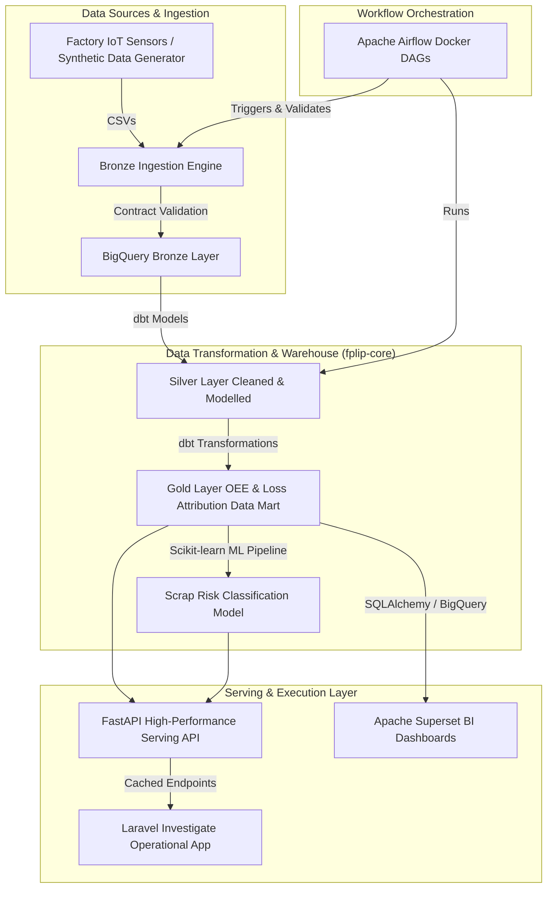

### Medallion Architecture Lineage & BigQuery Storage
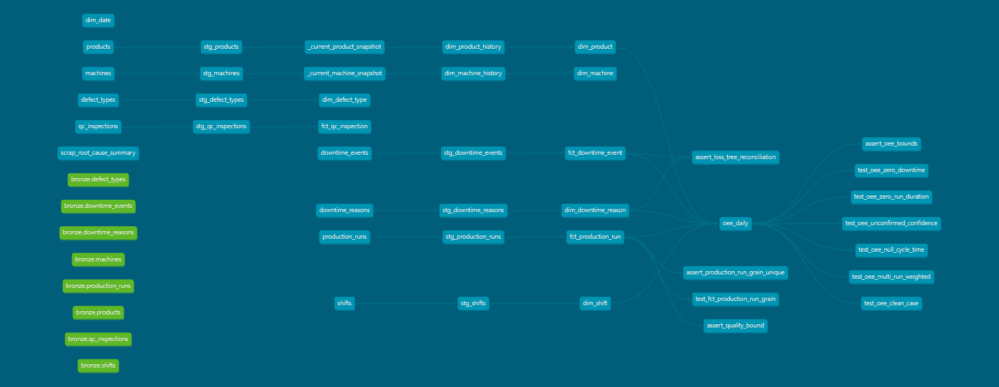
*Figure 1: Automated dbt Medallion Lineage Graph (Bronze $\rightarrow$ Silver $\rightarrow$ Gold)*

---

## 🛠️ Tech Stack & Key Technologies

| Category | Technologies |
| :--- | :--- |
| **Data Platform & Warehouse** | Google Cloud BigQuery, dbt (Data Build Tool), YAML Data Contracts |
| **Workflow Orchestration** | Apache Airflow (Dockerized LocalExecutor), Python 3.10 |
| **Serving API & ML** | FastAPI, Uvicorn, Scikit-learn, Joblib, Pydantic, Pandas, NumPy |
| **Operational Web App** | Laravel 11, SQLite/MySQL, Blade Templates, Tailwind CSS, Vite |
| **BI & Analytics** | Apache Superset, Docker Compose, ECharts |
| **Infrastructure & CI/CD** | Terraform (GCP IaC), GitHub Actions CI/CD |

---

## 🚀 Key System Features & Screenshots

### 1. Data Pipeline & Automated Quality Controls (`fplip-core`)
- **Bronze → Silver → Gold Architecture**: Automated medallion architecture inside BigQuery.
- **Shift-Left Data Contracts**: Incoming CSV event logs are validated against YAML contracts before ingestion.
- **Idempotent Airflow Ingestion**: Airflow DAGs enforce partition-decorator loads with `WRITE_TRUNCATE` semantics.
- **Hand-Rolled SCD2 Dimensions**: Tracks machine and product historical state changes using DDL window functions.

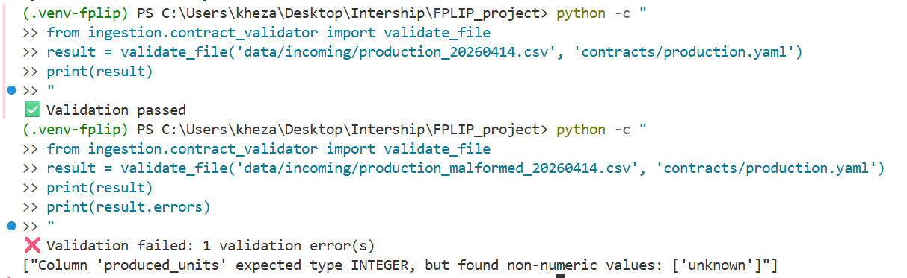
*Figure 2: Shift-Left YAML Data Contract Validation prior to Bronze Ingestion*

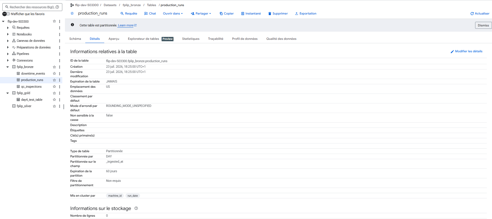
*Figure 3: Day-Partitioned BigQuery Sandbox Dataset Layout*

---

### 2. Workflow Orchestration & Automated DAGs
- **Airflow DAGs**: Parallel extraction, contract checking, dbt transformations, and data quality assertions.
- **Slack Alerting**: On-failure callbacks send immediate Slack notifications with log excerpts.

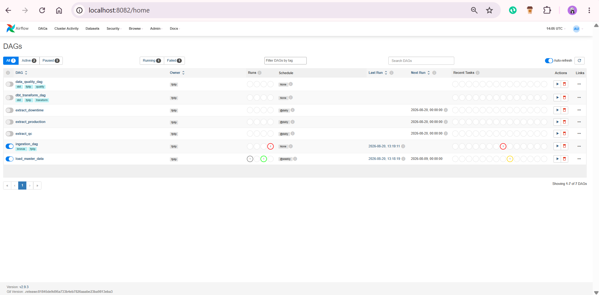
*Figure 4: Apache Airflow Web UI DAGs Overview (`ingestion_dag`, `dbt_transform_dag`, `data_quality_dag`)*

---

### 3. Operational Investigation Application (`fplip-investigate`)
- **Role-Based Access Control (RBAC)**: Dedicated interfaces for Plant Managers and Line Technicians.
- **Automated Anomaly Detection**: Signals trigger work orders when OEE drops below 75% or scrap exceeds 5%.
- **Ground AI Copilot**: Grounded Gemini AI diagnostic drawer restricted to 4 deterministic tool functions.
- **Technician Work Order Form**: Floor-level repair logging, physical finding description, and audit trail generation.

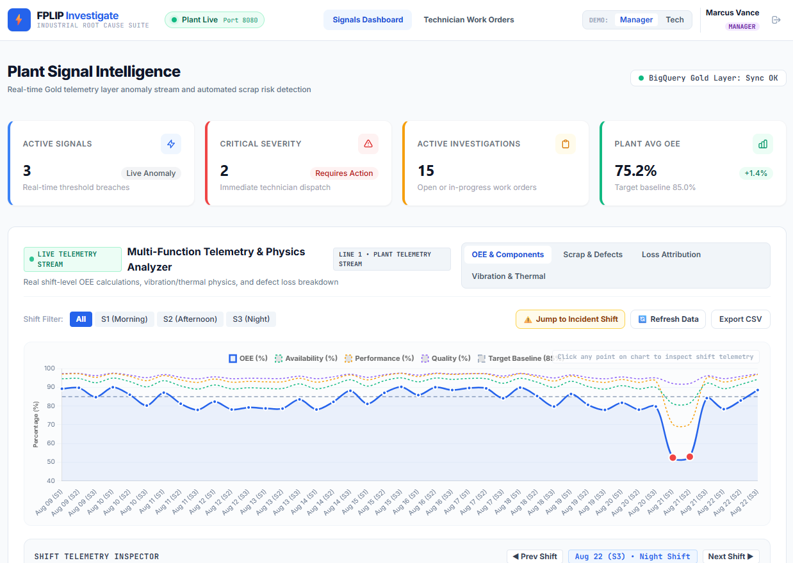
*Figure 5: Plant Signal Intelligence Dashboard showing Live Telemetry Stream and Shift Filters*

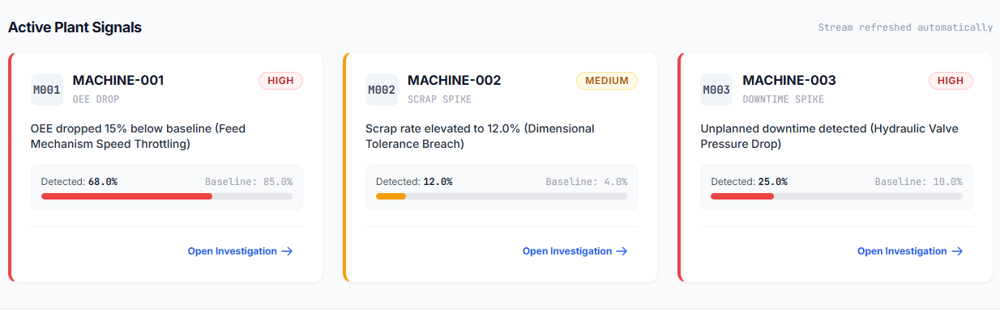
*Figure 6: Active Anomaly Signal Cards triggering automated investigation work orders*

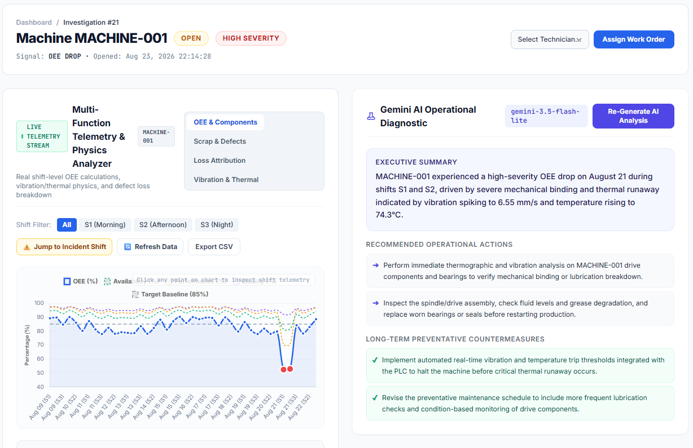
*Figure 7: Grounded Gemini AI Diagnostic drawer providing plain-language executive summaries and actions*

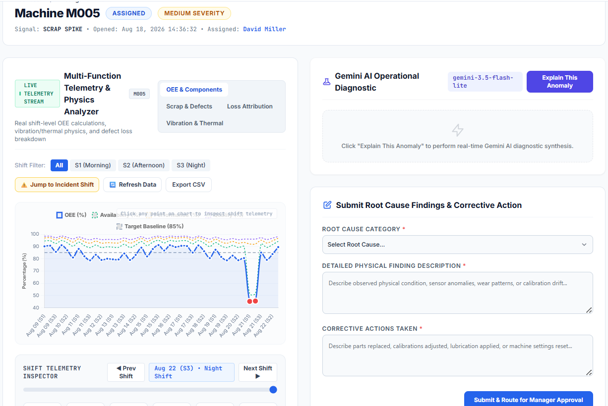
*Figure 8: Line Technician Root Cause Submission Form and Corrective Action Entry*

---

### 4. Business Intelligence & Dashboards (`fplip-bi`)
- **4-Row Storytelling Dashboard**: Executive KPI header, temporal trends, dimensional breakdowns, and scrap loss pareto.
- **4-Hour TTL Caching**: In-memory query caching to optimize BigQuery Sandbox query limits.

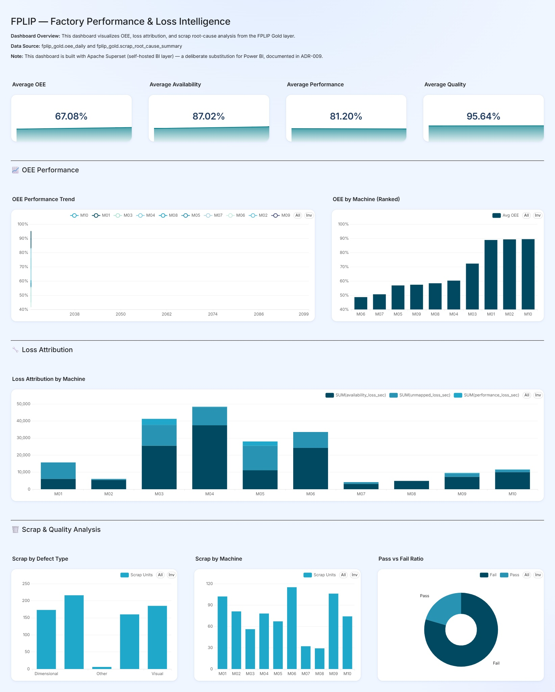
*Figure 9: Apache Superset 4-Row Storytelling OEE & Scrap Root Cause Analytics Dashboard*

---

### 5. Grounded ML Scrap Risk Classifier & CI/CD Pipeline
- **Logistic Regression Model**: Predicts high-risk scrap batches with high mathematical interpretability.
- **CI/CD Per-PR Isolation**: GitHub Actions 5-job workflow featuring ephemeral per-PR BigQuery datasets.

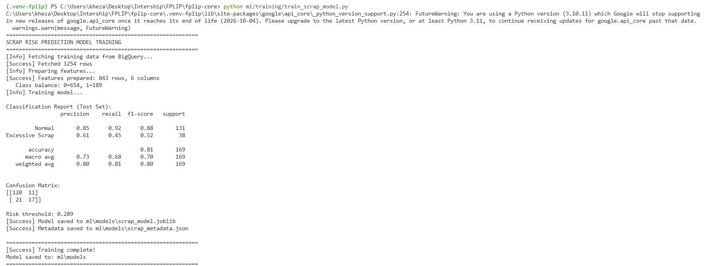
*Figure 10: Machine Learning Scrap Risk Classification Model Training Metrics & Confusion Matrix*

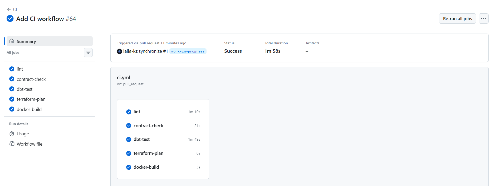
*Figure 11: GitHub Actions 5-Job CI/CD Workflow Execution Success*

---

## 📁 Repository Directory Structure

```text
.
├── fplip-core/                       # Main Data Platform, dbt, Airflow & ML Engine
│   ├── api/                          # FastAPI serving API (Endpoints, Auth, Caching)
│   ├── common/                       # GCP helper modules & authentication resolver
│   ├── contracts/                    # Data Contracts (Schema & Validation rules)
│   ├── dags/                         # Airflow DAGs (Ingestion, Transformation, Data Quality)
│   ├── data/                         # Incoming synthetic manufacturing datasets
│   ├── dbt/                          # dbt BigQuery data warehouse transformation models
│   ├── infra/                        # Terraform Infrastructure-as-Code scripts
│   ├── ingestion/                    # Extraction & synthetic generator engines
│   ├── ml/                           # ML scrap risk classification model & training scripts
│   ├── scripts/                      # Operational pipeline execution scripts
│   └── tests/                        # Integration & Unit test suite
│
├── fplip-investigate/                # Laravel 11 Operational Web Application
│   ├── app/                          # Controllers, Services, Models, AI Explanations
│   ├── database/                     # Migrations, seeders, and SQLite storage
│   ├── resources/                    # Blade templates, Tailwind CSS, Frontend assets
│   ├── routes/                       # Web & API routes
│   └── tests/                        # Application test suite
│
├── fplip-bi/                         # BI Dashboards & Visualizations
│   └── superset/                     # Apache Superset setup & configuration
│
├── docs/                             # Centralized Technical Documentation Hub
│   ├── architecture/                 # System architecture, GCP topology, performance reports
│   ├── adr/                          # Architectural Decision Records (ADR 001 - 018)
│   ├── data-dictionary/              # BigQuery Data Warehouse Data Dictionary
│   └── runbooks/                     # Operational runbooks & test execution reports
│
├── assets/                           # Portfolio Screenshots & Visual Evidence
│   ├── screenshots/                  # Standardized pipeline run evidence & GCP verifications
│   └── demo-screenshots/             # Categorized application UI & CLI execution screenshots
│
├── rapport/                          # Academic Report LaTeX Source (`report.tex`, `references.bib`)
├── .env.example                      # Global environment template
└── README.md                         # Master Portfolio Overview README
```

---

## 📊 Portfolio Screenshots & Evidence Catalog

System execution, BigQuery schema enforcement, and CI workflow run verifications are documented under [`assets/screenshots/`](assets/screenshots) and [`assets/demo-screenshots/`](assets/demo-screenshots):

| Category | Evidence Screenshot Link | Description |
| :--- | :--- | :--- |
| **Warehouse & Infrastructure** | [BigQuery Sandbox Active](assets/screenshots/bq_sandbox_active.png) | Active GCP BigQuery Sandbox project workspace |
| **Governance & Ingestion** | [Data Contract Validator](assets/screenshots/contract_validator.png) | Pre-ingestion YAML schema contract validation |
| **Partitioning & Loading** | [Partitioned BigQuery Tables](assets/screenshots/week2_day3_partitioned_table.png) | Ingestion partitioning by `_ingested_at` day decorator |
| **Transformations & Lineage** | [Data Lineage Graph](assets/screenshots/lineage_graph_week5.png) | Complete dbt Medallion DAG lineage graph |
| **dbt Build & Testing** | [dbt Model Build Success](assets/demo-screenshots/06_dbt_models_build_success.png) | Successful build of 13 table and 10 view models |
| **Quality Assertions** | [dbt Test Suite Execution](assets/demo-screenshots/07_dbt_test_suite_execution.png) | Pass rate across 85 schema, domain & unit tests |
| **Orchestration** | [Airflow DAGs Overview](assets/demo-screenshots/13_airflow_dags_overview.png) | Airflow UI showing active ingestion & transform DAGs |
| **Web App - Overview** | [Plant Signal Intelligence](assets/demo-screenshots/16_plant_signal_intelligence_dashboard.png) | Operational OEE telemetry stream and shift filters |
| **Web App - AI Grounding** | [Gemini AI Diagnostic](assets/demo-screenshots/18_gemini_ai_operational_diagnostic.png) | Tool-calling grounded LLM root cause synthesis |
| **Web App - Fix Workflow** | [Technician Submission Form](assets/demo-screenshots/19_technician_root_cause_submission_form.png) | Technician work order fix & audit trail entry |
| **Visual Analytics** | [Superset BI Dashboard](assets/screenshots/superset_dashboard_export.jpg) | Executive 4-Row OEE storytelling dashboard |
| **Machine Learning** | [ML Scrap Model Training](assets/demo-screenshots/12_full_dataset_ml_training_metrics.png) | Logistic Regression training report and metrics |
| **CI/CD Pipeline** | [CI Workflow Verification](assets/screenshots/ci_workflow_success.png) | 5-job GitHub Actions workflow with ephemeral PR isolation |

---

## 💻 Quick Start Guide

### 1. Run Data Platform & Serving API (`fplip-core`)
```bash
cd fplip-core
docker compose up -d
```
Access Airflow Web UI at `http://localhost:8080` (credentials: `admin` / `admin`).

### 2. Run Operational Web App (`fplip-investigate`)
```bash
cd fplip-investigate
composer install
npm install && npm run build
php artisan migrate --seed
php artisan serve --port=8081
```
Access Investigation Web App at `http://localhost:8081`.

### 3. Run BI Visualizations (`fplip-bi`)
```bash
cd fplip-bi/superset
docker compose up -d
```
Access Superset at `http://localhost:8088`.

---

## 📄 Documentation Hub & Academic Report
- For in-depth architectural design, data dictionaries, decision records, and operational runbooks, refer to the **[Technical Documentation Hub](docs/README.md)**.
- For the full 12-chapter academic report LaTeX source and references, refer to **[Academic Report Directory](rapport/README.md)**.
