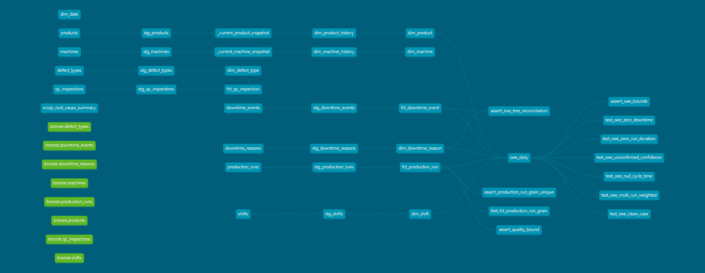

# 📚 FPLIP Technical Documentation Hub

Welcome to the central documentation index for the **Factory Performance & Loss Intelligence Platform (FPLIP)**.

---

## 🏛️ System Architecture Overview

*Figure: Complete dbt Medallion Architecture Lineage Graph (Bronze $\rightarrow$ Silver $\rightarrow$ Gold)*

---

## 📁 Documentation Index

### 1. Architecture & Design Specifications
- **[System Architecture](architecture/architecture.md)** — High-level architecture, pipeline design, data model topology, and component integration.
- **[GCP Topology](architecture/gcp-topology.md)** — Google Cloud BigQuery dataset structure, IAM roles, and storage configuration.
- **[API Endpoint Latency](architecture/Endpoint_latency.md)** — Benchmark metrics and performance analysis of FastAPI endpoints.
- **[Business Impact](architecture/business-impact.md)** — Value proposition, ROI calculation, and manufacturing operational impact.
- **[Scope Traceability Matrix](architecture/scope-traceability.md)** — Requirements mapping to implemented system features.

---

### 2. Architectural Decision Records (ADRs)
Browse architectural decisions made throughout the engineering lifecycle:
- **[ADR-001: Data Warehouse Selection](adr/ADR-001-warehouse-selection.md)** — GCP BigQuery Sandbox selection.
- **[ADR-002: Idempotent Bronze Ingestion Design](adr/ADR-002-idempotent-bronze-loading.md)** — Partition-decorator load strategy.
- **[ADR-003: SCD2 DML & Sandbox Handling](adr/ADR-003-scd2-blocked-by-sandbox-dml.md)** — DDL replacement pattern.
- **[ADR-004: History Tracking Pattern](adr/ADR-004-history-tracking-implementation.md)** — Lead window function tracking.
- **[ADR-005: Consistency Review](adr/ADR-005-week3-consistency-review.md)** — Cross-layer dimensional consistency.
- **[ADR-006: Fact Grain Validation](adr/ADR-006-fact-grain-validation.md)** — Explicit fact table grains.
- **[ADR-007: Gold Dimension Join Pattern](adr/ADR-007-gold-dimension-join-pattern.md)** — Fallback join strategies.
- **[ADR-008: OEE Edge Case Handling](adr/ADR-008-oee-edge-case-handling.md)** — Zero downtime & null cycle time handling.
- **[ADR-009: Data Quality Findings & Verification](adr/ADR-009-data-quality-findings.md)** — dbt testing taxonomies.
- **[ADR-010: Loss Attribution Output Schema](adr/ADR-010-loss-attribution-output-shape.md)** — Availability, Performance & Quality loss hours.
- **[ADR-011: Airflow DAG Architecture](adr/ADR-011-week6-dag-design.md)** — Modular Airflow DAG decomposition.
- **[ADR-012: Production Schedule Integration](adr/ADR-012-production-schedule.md)** — Planned production alignment.
- **[ADR-013: Airflow LocalExecutor Choice](adr/ADR-013-airflow-executor-choice.md)** — Containerized orchestration setup.
- **[ADR-014: Alerting & Metric Splitting](adr/ADR-014-alerting-split.md)** — Slack notification callbacks.
- **[ADR-015: API Key Management & Security](adr/ADR-015-api-key-storage.md)** — Environmental secrets resolver.
- **[ADR-016: Response Caching TTL Strategy](adr/ADR-016-caching-ttl.md)** — 4-hour in-memory API & BI cache.
- **[ADR-017: Foundation Phase Sign-off](adr/ADR-017-foundation-phase-complete.md)** — Core data platform sign-off.
- **[ADR-018: BI Tooling — Apache Superset Choice](adr/ADR-018-dashboard-tool-superset-over-powerbi.md)** — Selection of Apache Superset over proprietary BI tools.

---

### 📊 3. Data Warehouse Schema & Contracts
- **[Data Dictionary](data-dictionary/data_dictionary.md)** — Detailed column definitions, data types, and business rules for Bronze, Silver, and Gold BigQuery tables.

---

### 🛠️ 4. Runbooks & Testing Protocols
- **[Operational Runbook](runbooks/runbook.md)** — Step-by-step procedures for running, monitoring, and maintaining the data platform.
- **[Cold Restart Test Plan](runbooks/cold_restart_test_plan.md)** — Cold-start verification and disaster recovery procedures.
- **[Cold Restart Test Results](runbooks/cold_restart_test_results.md)** — Empirical verification log from automated cold restart test executions.
