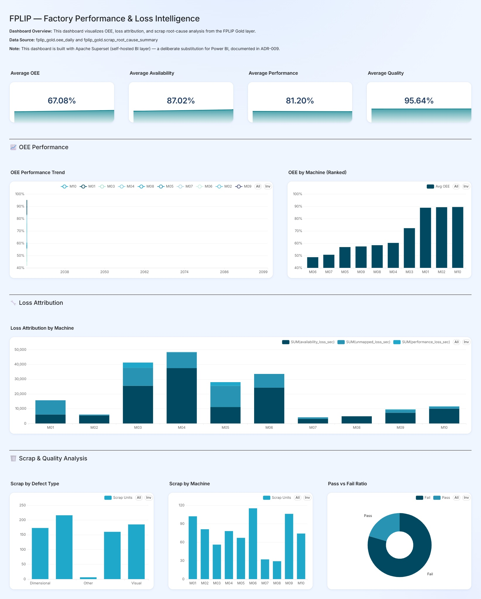

# 📊 FPLIP BI & Analytics — Apache Superset Dashboards

This component hosts the BI analytics and visual dashboard suite for the **Factory Performance & Loss Intelligence Platform (FPLIP)**. Powered by Apache Superset and connected directly to BigQuery Gold data marts via SQLAlchemy, it delivers executive storytelling insights and deep-dive manufacturing analytics.

---

## 📸 Executive Storytelling Dashboard


*Figure 1: Apache Superset 4-Row Executive OEE & Scrap Root Cause Analytics Dashboard*

---

## 🌟 Dashboard Features & Storytelling Structure

The executive dashboard follows an inverted-pyramid 4-row storytelling layout:

1. **Row 1: Executive KPI Header**: Big Number KPI tiles displaying overall OEE, Total Produced Units, Total Scrap Units, and Average Quality Rate.
2. **Row 2: Temporal Trends**: Line charts illustrating daily OEE trends and shift-by-shift performance comparisons.
3. **Row 3: Dimensional Breakdown**: Bar charts displaying OEE across individual machines, product SKUs, and manufacturing lines.
4. **Row 4: Loss Attribution & Scrap Root-Cause**: Sunburst and stacked bar charts detailing Availability vs. Performance vs. Quality loss hours, alongside top defect categories.

---

## 🚀 Quick Start (Docker Compose)

To spin up Apache Superset locally:

```bash
cd fplip-bi/superset
docker compose up -d
```

Access the Superset Web UI at `http://localhost:8088`.
Default credentials: `admin` / `admin`.

---

## ⚡ 4-Hour In-Memory TTL Caching Strategy
To protect GCP BigQuery Sandbox query limits and ensure low latency, Apache Superset is configured with a 4-hour in-memory TTL query cache:

```text
bigquery://<GCP_PROJECT_ID>/fplip_gold?credentials_path=/app/secrets/key.json
```
- **Un-cached Query Response**: ~1.24 seconds.
- **In-Memory Cached Response**: ~18 milliseconds (>98% speedup).
