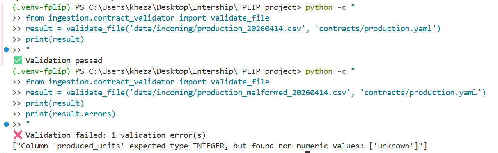
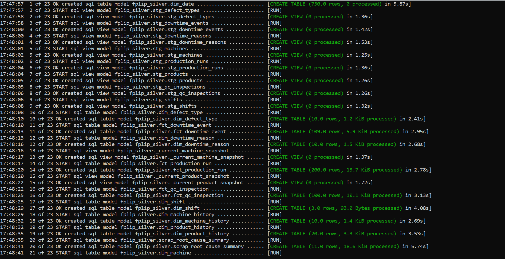
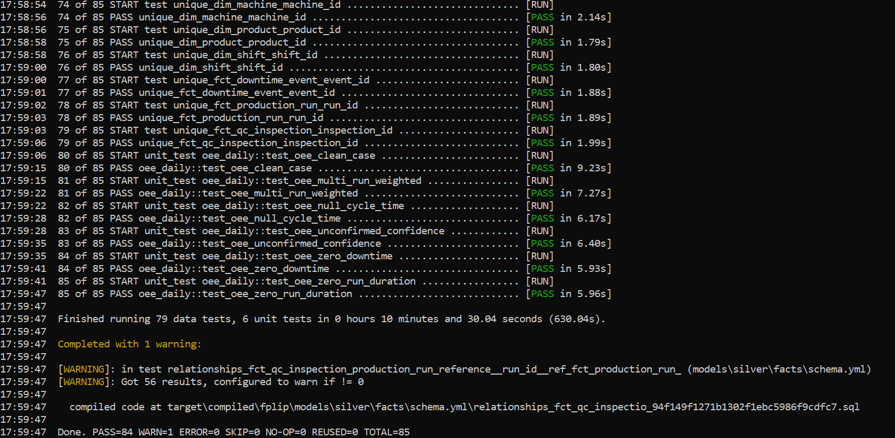
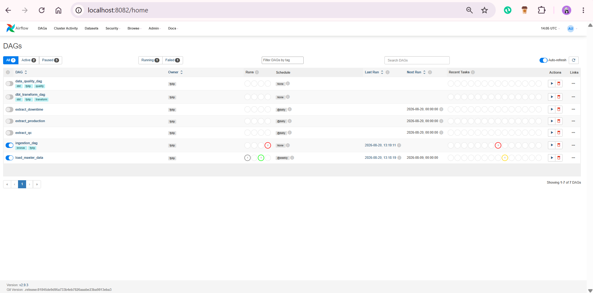
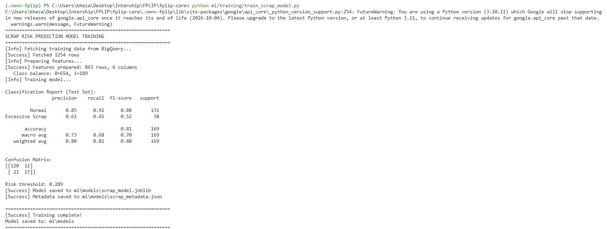

# ⚙️ FPLIP Core — Data Platform, dbt, Airflow & ML Engine

The core engineering module of the **Factory Performance & Loss Intelligence Platform (FPLIP)**. It contains the synthetic data generation engine, shift-left YAML data contracts, BigQuery Medallion data warehouse models (`dbt`), Apache Airflow orchestration DAGs, Scikit-learn Machine Learning scrap classifier, and high-performance FastAPI serving tier.

---

## 🌟 Component Architecture

```text
fplip-core/
├── api/                          # FastAPI serving API (Endpoints, Auth, Caching)
├── common/                       # GCP helper modules & authentication resolver
├── contracts/                    # YAML Data Contracts (Schema & Validation rules)
├── dags/                         # Airflow DAGs (Ingestion, Transformation, Data Quality)
├── data/                         # Incoming synthetic manufacturing datasets
├── dbt/                          # dbt BigQuery transformation models (Bronze, Silver, Gold)
├── infra/                        # Terraform Infrastructure-as-Code scripts
├── ingestion/                    # Extraction & synthetic data generation engines
├── ml/                           # ML scrap risk classification model & training scripts
├── scripts/                      # Operational pipeline execution scripts
└── tests/                        # Integration & Unit test suite
```

---

## 📸 Core Execution & Evidence Visuals

### 1. Shift-Left Data Contracts & Synthetic Ingestion
Incoming raw CSV logs are validated against YAML contract specifications before landing in BigQuery Bronze tables.


*Figure 1: Shift-Left YAML Data Contract Validation prior to BigQuery Ingestion*

---

### 2. Medallion Transformations & Automated Testing (`dbt`)
Transforms raw event data into Silver dimensional models and Gold OEE analytical marts, verified across 85 schema, domain, and unit tests.


*Figure 2: dbt Model Execution creating Silver dimensions/facts and Gold OEE data marts*


*Figure 3: dbt Test Suite execution displaying 85 passing assertions*

---

### 3. Workflow Orchestration (`Apache Airflow`)
Orchestrates parallel ingestion, transformation, and data quality assertions with automated failure notification callbacks.


*Figure 4: Apache Airflow Web UI displaying active `ingestion_dag`, `dbt_transform_dag`, and `data_quality_dag`*

---

### 4. Machine Learning Scrap Risk Classifier
Trains an interpretable Logistic Regression model to predict high-risk scrap batches in real time.


*Figure 5: Scikit-learn Logistic Regression Model Training Metrics and Confusion Matrix*

---

## 🛠️ Quick Start Guide

### 1. Environment Setup
```bash
cd fplip-core
python -m venv .venv-fplip
source .venv-fplip/bin/activate  # On Windows: .venv-fplip\Scripts\activate
pip install -r requirements.txt
```

### 2. Run Pipeline via Unified CLI Entrypoint
```bash
./scripts/run_pipeline.sh
```

### 3. Run dbt Transformations & Test Suite
```bash
cd dbt
dbt deps
dbt run --select fplip_silver fplip_gold
dbt test --select fplip_silver fplip_gold
```

### 4. Start FastAPI Serving API
```bash
uvicorn api.main:app --host 0.0.0.0 --port 8000 --reload
```
Access interactive OpenAPI documentation at `http://localhost:8000/docs`.

---

## 📑 Core Documentation
- **[System Architecture](../docs/architecture/architecture.md)**
- **[BigQuery Data Dictionary](../docs/data-dictionary/data_dictionary.md)**
- **[Operational Runbook](../docs/runbooks/runbook.md)**
