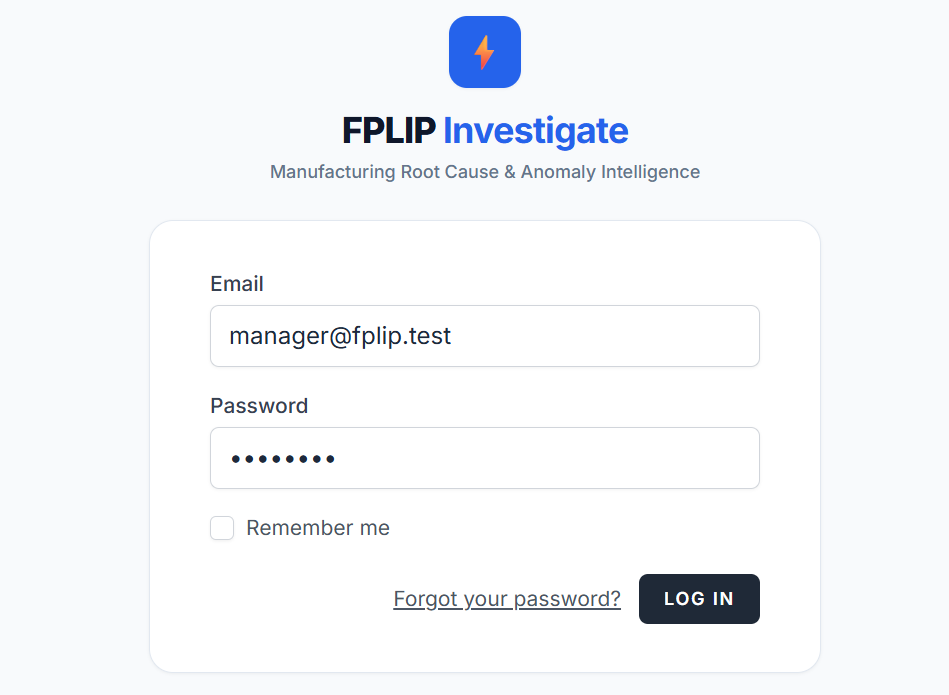
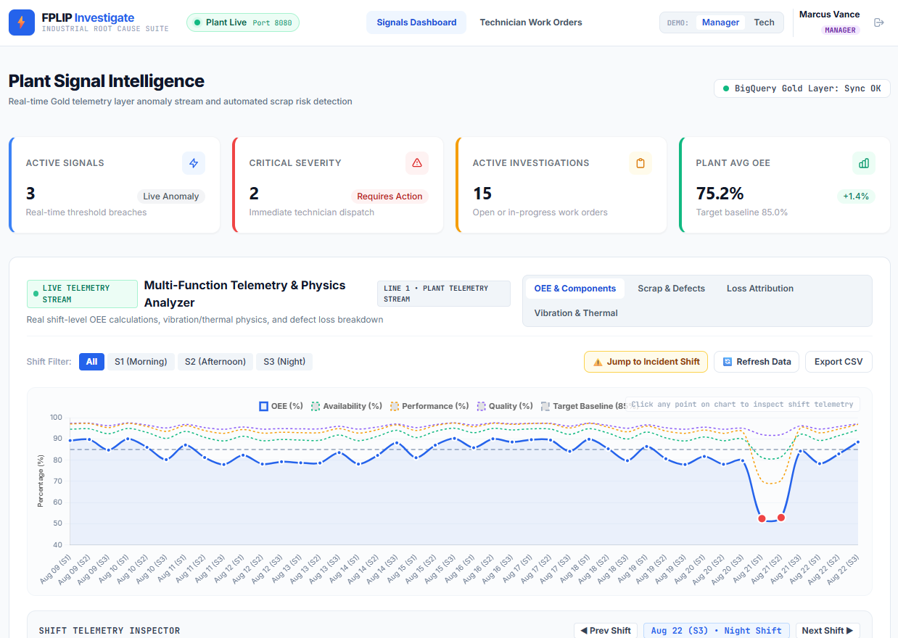
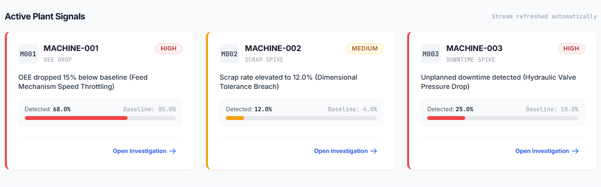
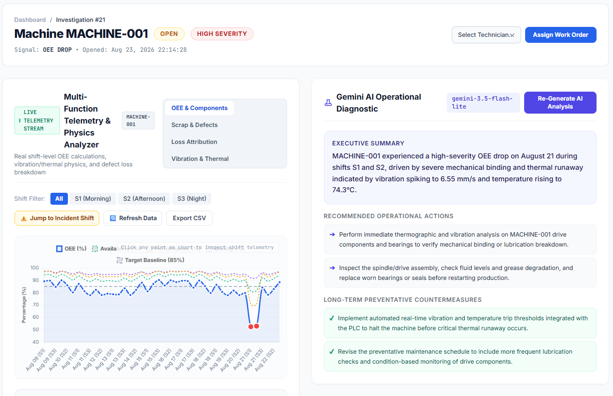
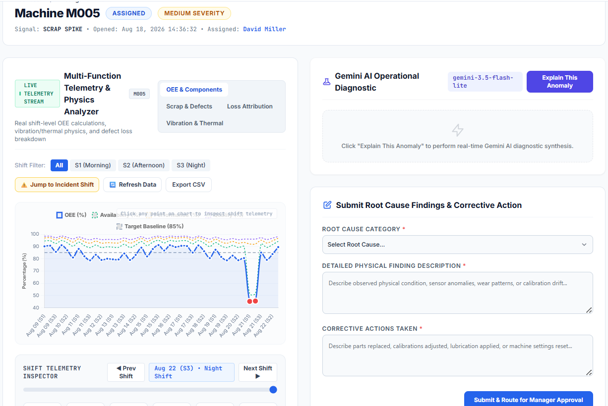

# 🔎 FPLIP Investigate — Operational Web Application

**FPLIP Investigate** is the operational web application module of the Factory Performance & Loss Intelligence Platform. Built with Laravel 11, Tailwind CSS, and Vite, it bridges plant floor operations with backend data platform intelligence.

---

## 📸 Application Screenshots & Workflow Features

### 1. Secure Authentication & Role-Based Access Control (RBAC)
Provides specialized user roles and permissions for **Plant Managers** and **Line Technicians**.


*Figure 1: FPLIP Investigate Secure Portal Login*

---

### 2. Plant Signal Intelligence Dashboard
Monitors real-time OEE telemetry streams, shift filters, and active plant performance metrics.


*Figure 2: Plant Signal Intelligence Dashboard with Live Telemetry Stream and Shift Inspector*

---

### 3. Active Anomaly Signal Cards & Investigation Triggers
Automated signal cards trigger work orders when OEE drops below 75% or scrap exceeds 5%.


*Figure 3: Active Anomaly Signal Cards triggering automated technician dispatches*

---

### 4. Grounded Gemini AI Operational Diagnostic
Integrates with Gemini LLM APIs restricted to 4 deterministic tool functions to synthesize plain-language root-cause explanations without hallucination.


*Figure 4: Grounded Gemini AI Diagnostic drawer providing executive summaries and action items*

---

### 5. Line Technician Root Cause Work Order Form
Floor-level repair logging, physical finding description, corrective action entry, and immutable audit trail generation.


*Figure 5: Line Technician Root Cause Submission Form and Fix Log*

---

## 🎯 Key Application Capabilities

- **Role-Based Workflows**: Tailored user dashboards for **Plant Managers** and **Technicians**.
- **Investigation Lifecycle**: Detect $\rightarrow$ Investigate $\rightarrow$ Assign $\rightarrow$ Fix $\rightarrow$ Close.
- **AI-Powered Explanations**: Grounded LLM diagnostic drawer providing clear action plans.
- **Audit Trail Governance**: Complete historical tracking of all user actions and anomaly state changes.

---

## 🚀 Setup & Execution

### Prerequisites
- PHP $\ge$ 8.2
- Composer
- Node.js & npm
- SQLite / MySQL

### Quick Start
```bash
cd fplip-investigate

# 1. Install PHP dependencies
composer install

# 2. Environment Setup
cp .env.example .env
php artisan key:generate

# 3. Frontend Compilation
npm install
npm run build

# 4. Database Setup & Seeding
php artisan migrate --seed

# 5. Serve Application
php artisan serve --port=8081
```

Access the application in your browser at `http://localhost:8081`.

---

## 🔗 Serving API Integration
FPLIP Investigate connects to `fplip-core` FastAPI serving endpoints via standard HTTP client calls configured in `.env`:

```env
FASTAPI_BASE_URL=http://127.0.0.1:8000
FASTAPI_API_KEY=your_api_key_here
FASTAPI_TIMEOUT=90
```
